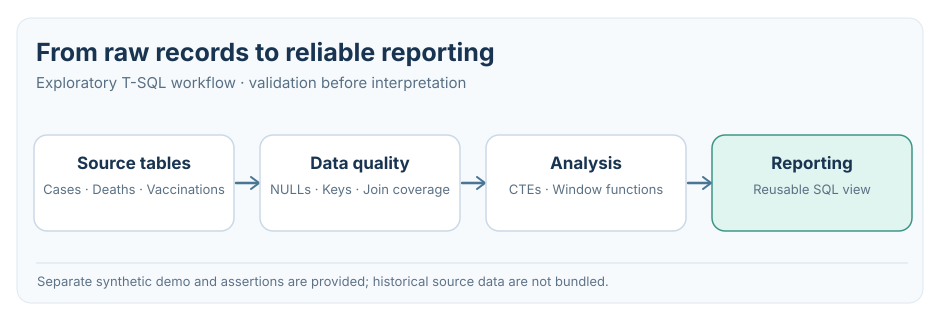

# COVID-19 Reporting & Data Exploration | SQL Server

**Data Analyst portfolio case study** · T-SQL · Data Quality · CTEs · Window Functions · Reporting Views

## Project summary

This project explores how to turn case, death, population, and vaccination tables into **reliable reporting queries**. It started as an exploratory SQL exercise and has been reorganized to make the analytical logic easier to review and test.



*Workflow overview. The included test database contains invented values; historical records and validated real-world results are not packaged.*

**Questions addressed**
1. How do reported cases and deaths change over time?
2. How do reported case-fatality percentages and cumulative cases per 100 inhabitants differ?
3. What are the latest reported totals for each country, rather than the historical maximum?
4. How can daily reporting be summarized using a rolling seven-reporting-day average?
5. How can vaccination data be joined to case data without silently dropping unmatched dates?

## Technical skills demonstrated

| Skill | Implementation |
| --- | --- |
| SQL querying | `SELECT`, `WHERE`, `GROUP BY`, `JOIN`, `ORDER BY` |
| Data validation | Duplicate-key, missing-value, numeric-conversion and join-coverage checks |
| Data preparation | `TRY_CONVERT`, `NULLIF`, appropriate `NULL` handling |
| Analytical SQL | CTEs, `ROW_NUMBER()`, rolling `AVG()` and `SUM() OVER` |
| Reporting | `dbo.vw_covid_vaccination_reporting` reusable SQL view |
| Verification | Isolated synthetic fixture and SQL Server assertions with known expected outcomes |

## Project structure

```text
PortfolioProjects/
├── README.md
├── covid_analytics_clean.sql            # Main reviewed analysis
├── checks/
│   └── 01_data_quality.sql              # Read-only input checks
├── demo/
│   └── 00_create_synthetic_database.sql # Invented demo records, isolated DB
├── tests/
│   └── 02_demo_assertions.sql            # Expected-result assertions
├── docs/
│   └── METRIC_DEFINITIONS.md            # Interpretation and caveats
└── Covid Project for Portfolio.sql      # Original exploratory script, preserved
```

## Quickstart: self-contained synthetic demo

**Requirements:** Microsoft SQL Server (SQL Server 2016 SP1+), a SQL client capable of running `GO` batches, and permission to create a demo database. This demo uses a **dedicated database** and does not require the original historical dataset.

1. Run [`demo/00_create_synthetic_database.sql`](./demo/00_create_synthetic_database.sql). It creates `CovidPortfolioDemo` and two tables containing **invented records**.
2. **Select `CovidPortfolioDemo` as the current database.**
3. Run [`covid_analytics_clean.sql`](./covid_analytics_clean.sql) from start to finish.
4. Run [`checks/01_data_quality.sql`](./checks/01_data_quality.sql) to review data completeness and join keys.
5. Run [`tests/02_demo_assertions.sql`](./tests/02_demo_assertions.sql). A successful run prints `PASS: all synthetic SQL Server demo assertions completed.`

**Safety:** Re-running the demo setup replaces only its own two tables and reporting view **within `CovidPortfolioDemo`**. Do not use that setup file for real customer, school, or production data. The testing script switches explicitly to the demo database, while the main analysis works in whatever database you selected.

### Expected synthetic outcomes

| Check | Expected demo result |
| --- | --- |
| Country-level case-report rows | 6 |
| Vietnam latest reported total cases | 200 |
| Vietnam synthetic case-fatality percentage on day 3 | 2.0% |
| Vietnam known cumulative vaccination events on day 3 | 60 |
| Canada known cumulative vaccination events on day 3 | 20 |
| Canada day-2 reported new vaccinations | `NULL` |
| World aggregate included in country-level view? | No |

**These are made-up test values, not historical COVID-19 findings.**

## Running with an actual dataset

The legacy project referenced two tables, previously named `PortfolioProject..CovidDeaths` and `PortfolioProject..CovidVaccination`. The cleaned script accepts equivalent tables named **`dbo.CovidDeaths`** and **`dbo.CovidVaccination`** inside the currently selected database.

Expected columns:

- **CovidDeaths:** `continent`, `location`, `date`, `population`, `total_cases`, `new_cases`, `total_deaths`, `new_deaths`
- **CovidVaccination:** `location`, `date`, `new_vaccinations`

The original real dataset files, their exact snapshot, and ingestion steps **were not supplied with this repository**. To reproduce historical results, first obtain appropriately licensed, documented source data and import/validate the columns above. Run the read-only quality checks before interpreting the queries. **Never run the synthetic demo setup in your real-data database.**

## Analytical choices and limitations

- Use **latest available reporting dates** per country rather than summing cumulative records across dates or assuming the maximum is the latest value.
- Filter to records with non-null `continent` to reduce accidental inclusion of global/regional aggregates; confirm how your particular source classifies records.
- The view uses a **left join** to retain case-report dates without vaccination observations; missing daily vaccination values remain `NULL`.
- The seven-reporting-day average operates on **available report rows**, which may not correspond to seven consecutive calendar days.
- See [metric definitions and caveats](./docs/METRIC_DEFINITIONS.md) for precise interpretation.

## Validation status

- **Uploaded and checked on GitHub:** README, analysis, fixture, data-quality checks and assertions.
- **Expected test numbers:** cross-checked from the synthetic fixture values.
- **SQL Server execution:** not yet run against a live SQL Server engine; the assertion script is provided for you to execute before citing a fully tested portfolio.
- **Real-world insights:** not claimed until a versioned real dataset and independently verified outputs are added.

## Original work

[View the original exploratory SQL file](./Covid%20Project%20for%20Portfolio.sql). It is preserved as historical work rather than edited into the new version.

---

**Vy Huynh** · MSc Big Data Analytics candidate · [GitHub profile](https://github.com/vyhuynh071200)
